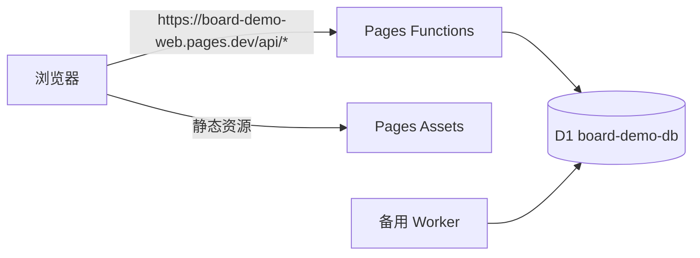

# board-demo · 留言板最小全栈 Demo

一个真正部署在公网的极简留言板：Cloudflare Pages（前端 + 同源 API）+ D1（数据库）。全程 0 元额度内。

架构（2026-11-04 调整）：
- **主链路（线上实际使用）**：前端静态资源与 `/api/*` 都在 `board-demo-web.pages.dev` 同一个域名下。`web/public/_worker.js`（Pages Functions advanced mode）接管 `/api/*`，其余请求交给 `env.ASSETS`。没有跨域，也没有 `*.workers.dev` 依赖。
- **备用链路**：`worker/` 仍是可独立部署的 Worker（`board-demo-api.xiaokaixin12.workers.dev`），供直连调试使用。接口实现只有一份：`web/public/_worker.js` 由 `scripts/build-pages-worker.mjs` 从 `worker/src/index.js` 生成，不要手改。



## 目录
```
web/     Vite + React + TypeScript 前端（负责人：前端开发bb）
worker/  原生 fetch + Cloudflare Workers + D1 后端（负责人：后端开发乐震）
infra/   部署脚本、线上验证、回滚说明（负责人：运维小博）
docs/    API 契约、验收清单（负责人：全能小源）
```

> 与最初选型的偏差：原计划用 Hono，为减少部署依赖，最终改为**零依赖原生 Worker**（约 140 行，可直接粘贴进控制台）。路由、校验、CORS 行为与 `docs/API-CONTRACT.md` 一致，后续可平滑换 Hono。决策记录见 `docs/DECISIONS.md`。

## 接口
见 `docs/API-CONTRACT.md`。前端默认请求同源相对路径 `/api/*`（`VITE_API_BASE` 留空）；本地联调时可指向 mock 或 Worker。

## 海斗助手（`/haidou`）

在同一站点新增的第二个页面：输入英雄名，查看**海斗（海克斯大乱斗 / ARAM）**当前版本的推荐装备、海克斯强化与胜率榜。与留言板共用同一个 Pages 项目和同一个域名，没有新增后端或数据库。

- **专属域名（推荐）**：https://haidou.pages.dev —— 根路径即海斗助手，独立 Pages 项目 `haidou`，与留言板共用同一个 D1 库
- 旧入口（保留）：https://board-demo-web.pages.dev/haidou
- 功能：英雄搜索（中文名 / 英文别名 / 称号 / 中文外号 / 全拼 / 首字母，如「压缩」「yasuo」「ys」）、胜率榜（173 位英雄，可按定位筛选）、英雄详情（核心装 / 鞋子 / 出门装 / 后续装备 / 技能加点 / 召唤师技能 / 强化排序 / 双强化组合）
- 页面形态：独立多页入口 `web/haidou.html`，页内用 hash 路由（`#/`、`#/rank`、`#/c/{id}`），不依赖 SPA fallback

### 英雄别称与拼音

`web/public/data/haidou.json` 的每个英雄新增三个字段：`aliases`（中文外号）、`pinyin`（官方名全拼）、`pinyinInitials`（首字母）。别称表维护在 `scripts/champion-aliases.mjs`，173 位英雄全覆盖；重新生成数据时会自动合并，也可以单独回填：

```bash
PATH=/opt/homebrew/bin:$PATH node scripts/apply-champion-aliases.mjs
```

搜索匹配顺序：官方名 → 英文名 → 中文外号 → 全拼 → 首字母 → 称号。命中外号或拼音时，结果里会显示「俗称 xxx / 拼音 xxx」标签。

## 海斗 MCP（给大模型用的接口）

同一 Pages 站点直接暴露一个 **Streamable HTTP MCP**，0 元、无需鉴权、无需额外账号，复用 `/data/haidou.json` 静态数据。

- 端点：`https://board-demo-web.pages.dev/mcp`
- 传输：`POST /mcp`（JSON-RPC 2.0，单条或批量）；`GET /mcp` 返回 405（本服务不提供 SSE 推送）
- 能力：仅 tools，全部只读
- 协议版本：`2025-06-18` / `2025-03-26` / `2024-11-05`，按客户端请求回显

### 工具清单

| 工具 | 用途 | 主要参数 |
| --- | --- | --- |
| `search_champion` | 按名字/外号/称号/英文名/拼音/首字母搜英雄 | `query`、`limit` |
| `recommend_champions` | 回答「玩谁 / 哪个英雄强」，可按定位过滤 | `role`、`sort`(win/pick)、`count` |
| `get_build` | 出装：核心装、鞋子、出门装、后续装、加点、召唤师技能 | `champion`、`style`(可选) |
| `get_augments` | 海克斯强化与最佳双强化组合（海斗没有传统符文） | `champion`、`sort`、`limit` |
| `get_rankings` | 胜率榜，可按定位过滤 | `role`、`limit` |
| `get_champion_profile` | 一次返回强度 + 出装 + 强化完整档案 | `champion` |

### 接入方式

支持远程 MCP 的客户端（Claude Code / Claude Desktop 自定义连接器 / 其他兼容客户端）直接填上面的 URL 即可。Claude Code：

```bash
claude mcp add --transport http haidou https://board-demo-web.pages.dev/mcp
```

通用 JSON 配置：

```json
{
  "mcpServers": {
    "haidou": {
      "type": "http",
      "url": "https://board-demo-web.pages.dev/mcp"
    }
  }
}
```

### 本地自测

```bash
curl -s https://board-demo-web.pages.dev/mcp \
  -H 'content-type: application/json' \
  -d '{"jsonrpc":"2.0","id":1,"method":"tools/call","params":{"name":"search_champion","arguments":{"query":"压缩"}}}'
```

返回内容为 Markdown 文本，模型可直接阅读。数据版本、统计日期与「非官方统计」声明由工具输出自带，页面不展示数据来源。

**数据来源与口径**：静态快照来自 [LOLDAA · HEX PICK](https://loldaa.com/data) 的公开页面数据（`aramkit` 接口），游戏版本 **16.21**，统计日期 **2026-11-02**，口径为海斗全段位。数据非 Riot 官方数据，样本量小的英雄/强化波动较大。**页面与接口不展示数据来源，仅保留版本、统计日期与「非官方」声明**；来源信息只保留在本文档中，用于内部追溯与版权说明。

**为什么是静态快照**：抓取结果已落成 `web/public/data/haidou.json`（约 461 KB，173 英雄 / 155 件装备名 / 166 个强化说明），由 Pages 静态托管。这样不需要新增 Worker 路由、D1 表或定时任务，0 元额度内不会因为查询消耗 D1 读写；代价是数据不会自动更新，需要重新生成并部署。

**重新生成数据**：

```bash
export PATH=/opt/homebrew/bin:$PATH
cd web
npm run data:haidou      # 读取原始抓取文件，覆盖 public/data/haidou.json
npm run build            # 重新构建后再按上面的 Pages 流程部署
```

`scripts/build-haidou-data.mjs` 的输入路径可用 `RAW_CHAMPS` / `RAW_CATALOG` / `ITEM_JSON` / `SPELL_JSON` 覆盖，默认读取本机抓取缓存。原始数据与英雄/装备/强化图标版权归 Riot Games 与 LOLDAA；图标通过 `loldaa.com` 外链加载，若对方限流或下线，页面会显示首字占位而不是破图。

## 本地启动

```bash
# 终端 node/npm 在 /opt/homebrew/bin，默认 PATH 里没有
export PATH=/opt/homebrew/bin:$PATH

cd web
npm run mock        # 本地 mock API：http://localhost:8787
npm run dev         # 前端：http://localhost:5173（web/.env 设为 VITE_API_BASE=http://localhost:8787）
```

`npm run build` 会先运行 `scripts/build-pages-worker.mjs` 生成 `web/public/_worker.js`，再打包。产物 `web/dist` 根目录必须包含 `index.html`、`assets/`、`_worker.js`。

后端不依赖 wrangler 也可本地起：`worker/src/index.js` 需要 D1 绑定，本机没有 wrangler 时用 `npm run mock` 顶替；有网后按 `infra/DEPLOY.md` 的 A 路径 `wrangler dev`。

## 部署

完整步骤、回滚与验证见 **[infra/DEPLOY.md](infra/DEPLOY.md)**，这里只给最短路径。

正规方式（需终端可出网）：

```bash
export PATH=/opt/homebrew/bin:$PATH
cd worker
npx wrangler d1 create board-demo-db          # 首次，把 database_id 写回 wrangler.toml
npx wrangler d1 migrations apply board-demo-db --remote
npx wrangler deploy

cd ../web
VITE_API_BASE= npm run build          # 留空 => 同源 /api
npx wrangler pages deploy dist --project-name=board-demo-web
```

Pages 项目需要在 Settings → Functions → D1 bindings 里绑定 `DB` → `board-demo-db`（preview 与 production 各一份）。绑定缺失时 `/api/*` 会返回 500。

若无法使用 CLI，走控制台手工路径：D1 建库 → 控制台执行 `worker/migrations/0001_init.sql` → Pages 绑定 `DB` → 上传 `web/dist` zip（zip 根目录就是 `index.html` / `assets/` / `_worker.js`）。详见 `infra/DEPLOY.md` B 节。

**线上实例（2026-11-04）**
- 线上入口（前端 + API 同源）：https://board-demo-web.pages.dev
- 海斗助手（专属域名）：https://haidou.pages.dev （2026-11-05 新增；根路径即海斗页）
- 海斗助手（旧入口）：https://board-demo-web.pages.dev/haidou
- 健康检查：https://board-demo-web.pages.dev/api/health → `{"ok":true}`
- 备用直连 API：https://board-demo-api.xiaokaixin12.workers.dev （部分网络访问 `workers.dev` 不稳定，不影响主链路）

发布后必须验证：`BASE_URL=https://board-demo-web.pages.dev bash worker/scripts/smoke.sh` 全 PASS。

回滚：Pages 在 Deployments 里 Rollback to this deployment（当前可回滚到 `6b30c52b`，那是接入同源 API 之前的版本，需要配合前端 `VITE_API_BASE` 指向 Worker）；D1 发布前先 Export 备份 —— 应用回滚不等于数据回滚。

## 免费额度与限制

| 项 | 免费额度 | 触顶表现 |
|---|---|---|
| Workers | 10 万请求/天，单次 CPU 10ms | 请求被拒 / 429 |
| Pages | 带宽与请求不限，500 次构建/月 | 构建失败、上传被拒 |
| D1 | 5GB 存储，500 万行读/天，10 万行写/天 | 查询报错 |

红线：无 SLA、额度为账号级共享，**不得用于生产关键业务**。单条留言限 200 字、列表固定 `LIMIT 100`，不做定时任务和批量导入。

## 访问统计

已启用 Cloudflare Web Analytics（Free，无 Cookie、不采集个人身份）。部署后页面 HTML 会自动带上 `cloudflareinsights.com` 的 beacon 脚本。

查看路径：Cloudflare 后台 → Workers 和 Pages → `board-demo-web` → 指标 → Web Analytics（或 数据分析 → Web Analytics → `board-demo-web.pages.dev`）。

可看：访问量、页面浏览量、页面路径、来源、国家/地区、设备与 Core Web Vitals（LCP/INP/CLS）。数据有几分钟延迟。注意：

- 统计的是**页面浏览**，不是 API 请求；接口调用量看同一页面的「请求 / 子请求」指标。
- 上线初期数字包含我们自己的测试访问，不代表真实用户量。
- 若 `pages.dev` 在部分网络不可达，Web Analytics 的 beacon 也可能一并失败，数据会偏低。

## 绑定自有域名

1. 域名接入 Cloudflare（NS 指向 Cloudflare）。
2. Pages → Custom domains → 添加（如 `board.example.com`）。API 是同源的，**不需要**单独的 `api.` 子域。
3. 无需改前端代码，重新部署一次即可（域名切换不影响构建产物）。
4. 验证 `curl -s https://board.example.com/api/health` = `{"ok":true}`。

面向国内用户还需完成 ICP 备案并使用境内节点。

## 国内访问说明

- 在部分中国大陆网络下，`*.workers.dev` 无法建立连接（域名级），因此主链路使用 Pages 同源 `/api/*`，`worker/` 仅作海外调试备用。
- `*.pages.dev` 在多数大陆网络可直连，但属 DNS 污染型，不保证长期稳定。
- 面向国内用户正式提供服务，建议自有域名 + ICP 备案 + 境内节点；上线前在多家运营商线路各测一次页面与 `/api/health`。
- 对外统一表述为「当前可用，非承诺」：Cloudflare 免费版对大陆无 SLA。

## 分支与协作约定
- 单仓库，禁止各自复制一份
- 分支：`feat/web`（bb）、`feat/worker`（乐震）、`feat/infra`（小博），合并到 `main`
- 同一文件只允许一位负责人改动；跨目录改动先在群里说
- 接口实现只改 `worker/src/index.js`，`web/public/_worker.js` 是构建产物，不提交
